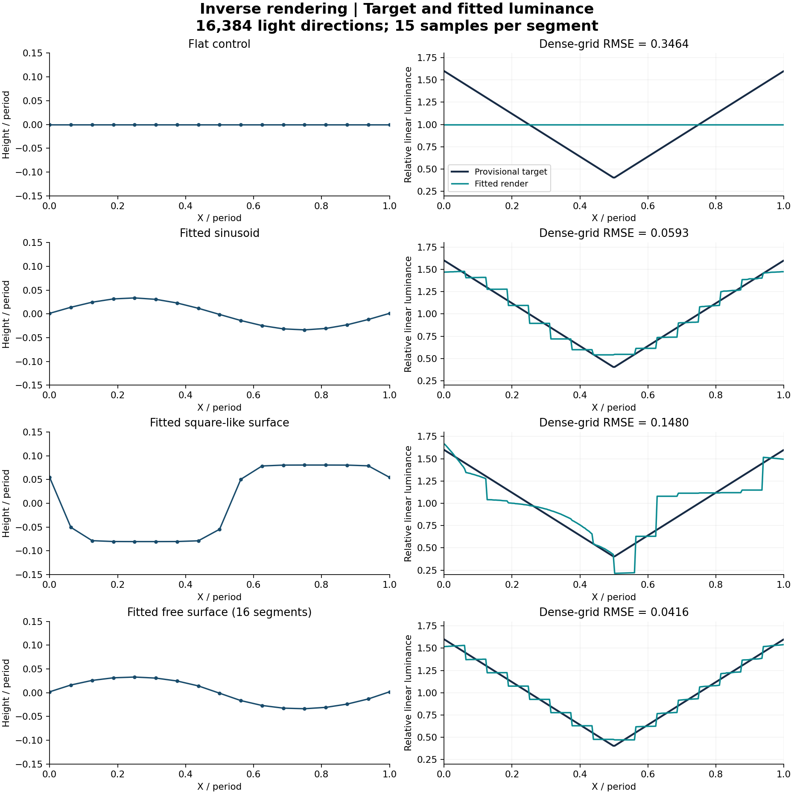

# Square-wave illusion: physical simulation

**Design and Analysis of Experiments | Group 2 | Computational study, 22 October 2026**

Can a corrugated matte surface under directional environmental illumination reproduce the triangle-wave luminance pattern associated with the square-wave illusion?

**All six computational steps are implemented**, including joint geometry-and-lighting optimization. The repository includes reproducible candidate fits and numerical validation. The target and physical constraints define the baseline model studied here.

## Start here

- **[Readable project report (PDF)](docs/project_report.pdf)**
- **[Executed notebook](simulation_walkthrough.ipynb)**: model explanation, plots, and saved fitted results.
- **[Results and interpretation](docs/RESULTS.md)**
- **[Detailed methods](docs/METHODS.md)**
- **[Limitations and future work](docs/LIMITATIONS.md)**

## Current result

The N=16 free-surface candidate has RMSE **0.04155**; an additional N=32 fit has RMSE **0.02110**, with target mean luminance one. This is a candidate physical image match within the stated model. It does not establish a unique perceived shape or the cause of the illusion.

| Model | N | Dense RMSE | MAE | R-squared |
|---|---:|---:|---:|---:|
| Flat control | 16 | 0.34640 | 0.30000 | -0.0000 |
| Sinusoid | 16 | 0.05928 | 0.04822 | 0.9707 |
| Square-like | 16 | 0.14801 | 0.11537 | 0.8174 |
| Free surface | 16 | 0.04155 | 0.03588 | 0.9856 |
| Free surface: resolution check | 32 | 0.02110 | 0.01813 | 0.9963 |



## Completed scope

1. Periodic height-field geometry, planar segments, and surface normals.
2. Binary direct-light visibility, with shadows from neighboring cycles.
3. Approximately equal-solid-angle sphere sampling.
4. Lambertian integration of visible light directions.
5. von Mises-Fisher lighting with two direction angles and concentration kappa.
6. Joint fitting of geometry and lighting, with explicit bounds and a curvature penalty.

Validation includes 15 physical/numerical checks and eight regression tests. Reference fitting uses three seeds for each of four families; additional cases examine geometry resolution, smoothness, lighting concentration bounds, and numerical integration. Free-surface global searches reached their iteration budgets; successful local refinement does not prove a global optimum.

## Quick start

Use Python 3.10 or newer. Saved reference outputs were generated with Python 3.12.2; package versions are in `requirements-reference.txt` and `results/environment.json`.

```sh
python3 -m venv .venv
source .venv/bin/activate
python -m pip install -r requirements.txt
python validate.py
python -m unittest -v test_project.py
python run_demo.py
```

On Windows, activate the environment with `.venv\Scripts\activate` instead. To inspect results, no optimization rerun is needed: the notebook, figures, JSON, CSV, and PDF are included.

To edit and rerun notebook cells locally, install the optional notebook tools with `python -m pip install -r requirements-notebook.txt`, then run `jupyter lab simulation_walkthrough.ipynb`. Select the Python environment containing the project dependencies.

## Reproduce the fitted results

From this repository root:

```sh
python run_all.py --full
```

This reruns validation, examples, fitting, analysis, summaries, notebook execution, and tests. It replaces generated outputs in `results/`, the README and result summary, and the notebook. Optimization runtime depends on the computer; the reference fit stage took under two minutes in this environment, with analysis/sensitivity taking additional time. Set `OPENBLAS_NUM_THREADS=1` before running direct individual scripts for comparable CPU behavior; `run_all.py` does this automatically.

The equivalent individual stages are:

```sh
python fit.py --config configs/reference.json
python analyze.py
python build_review.py
```

A quick check without refitting is `python run_all.py --quick`. To rebuild the PDF after a full run, install `requirements-report.txt` and run `python build_report.py`. The PDF build is separate so ordinary scientific use does not depend on the document-authoring libraries.

## Assumptions that affect interpretation

The surface repeats along X, extends along Y, and is viewed orthographically. Albedo is constant; only direct Lambertian light is modeled. Vertical walls, overhangs, light bouncing between surface parts, and calibrated display response are excluded. Square-like surfaces have finite ramps.

The provisional target has period one, mean one, and Michelson contrast 0.6. Total angular radiance is fixed. Fitting uses absolute linear luminance without a free gain or offset. Heights have zero mean to remove translation redundancy. The light mean is limited to one mirror-equivalent azimuth half-sphere and elevations 5–85 degrees.

**Do not assess the fit only at segment midpoints:** that can hide substantial between-midpoint error. Reported primary errors use 15 samples per segment and 16,384 directions. N=32 is an additional one-seed case rather than part of the main three-seed comparison.

## Repository map

```text
model.py                       Geometry, visibility, lighting, renderer
fit.py                         Four model families and bounded fitting
analyze.py                     Refinement, dense evaluation, sensitivity
validate.py                    15 physical/numerical checks
test_project.py                8 regression tests
run_demo.py                    Forward simulation examples
run_all.py                     Reproduction entry point
build_review.py                Summaries and executed notebook
build_report.py                Optional PDF build
configs/reference.json         Target, bounds, and search settings
simulation_walkthrough.ipynb    Explanation with embedded outputs
docs/                          Report, methods, results, review/upload guides
results/                       Generated figures, profiles, settings, fits
.github/workflows/checks.yml   Automated checks on pushes/pull requests
```

## Limitations and future work

The results are conditional on the baseline target and model assumptions. Further work can assess alternative targets, higher geometry resolution, additional illumination models, and perceptual validation. See [limitations and future work](docs/LIMITATIONS.md) and [references](docs/REFERENCES.md).
