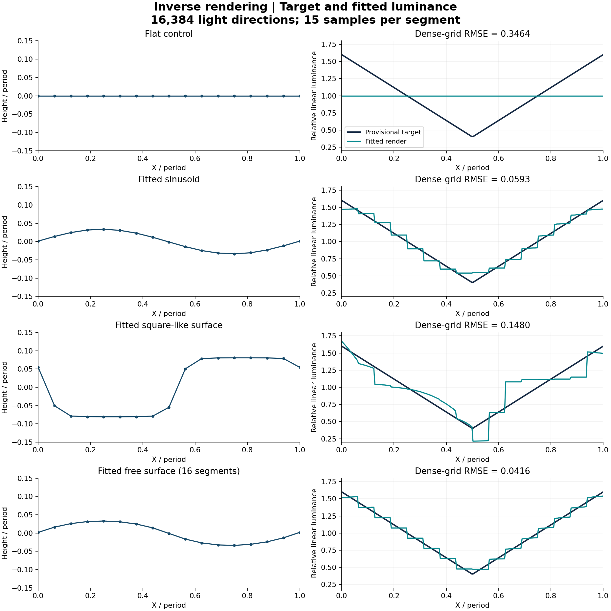

# Square-wave illusion: physical simulation

**Design and Analysis of Experiments | Group 2 | Computational study**

In the square-wave illusion ([Leguire, Blake, and Sloane, 1981](https://doi.org/10.1126/science.212.4499.1172)), a striped pattern whose brightness rises and falls like a triangle wave is sometimes seen as sharp square bars. This project asks a physical question about that pattern: can a corrugated matte surface, lit more strongly from one direction, produce the same triangle-wave brightness?

## Answer

Yes, within the stated model. A shallow, smooth corrugation under side lighting traces the triangle wave closely. It is not shaped like square bars. This shows one physical scene that can produce the image; it does not identify the shape people perceive or explain the illusion.

| Model | Segments | Error (RMSE) | R-squared |
|---|---:|---:|---:|
| Flat control | 16 | 0.34640 | 0.000 |
| Sinusoid | 16 | 0.05928 | 0.971 |
| Square-like | 16 | 0.14801 | 0.817 |
| Free surface | 16 | 0.04155 | 0.986 |
| Free surface, resolution check | 32 | 0.02110 | 0.996 |

Target mean brightness is one, so an error of 0.04 is about 4% of the mean.



## Figures

Read them in order:

1. `1_target.png`: the brightness pattern we want to reproduce.
2. `2_forward_model.png`: brightness produced by preset surfaces, with and without shadows.
3. `3_shadow_check.png`: which points a low light reaches, and which are shadowed.
4. `4_model_comparison.png`: four fitted surfaces against the target (the main result).
5. `5_best_fit_N32.png`: the best fit, using 32 segments.
6. `6_sensitivity.png`: whether the answer changes with resolution or settings.

Details are in [docs/RESULTS.md](docs/RESULTS.md), and the model is described in [docs/METHODS.md](docs/METHODS.md).

## Layout

```text
config.json              Target, bounds, and search settings
src/model.py             Geometry, shadows, lighting, renderer
src/fit.py               Four model families and bounded fitting
src/analyze.py           Refinement, dense scoring, sensitivity, figures 4-6
src/demo.py              Explanatory figures 1-3 (no fitting)
src/build_report.py      Optional PDF report
tests/test_project.py    15 physical checks and regression tests
run_all.py               Runs the pipeline
notebook.ipynb           Walkthrough with saved outputs
docs/                    Methods, results, limitations, and the PDF report
results/figures/         The six figures
results/data/            fits.json (raw searches) and analysis.json (master record)
```

## Quick start

Use Python 3.10 or newer.

```sh
python3 -m venv .venv
source .venv/bin/activate
python -m pip install -r requirements.txt
python run_all.py --quick
```

`--quick` regenerates figures 1-3 and runs the tests. On Windows, activate with `.venv\Scripts\activate`.

To reproduce the fits, run `python run_all.py --full`. This reruns the search and analysis and replaces the files in `results/`. The fit stage took under two minutes on the reference machine; analysis and sensitivity take longer.

To open the notebook or rebuild the PDF, install `requirements-extras.txt`. Then run `jupyter lab notebook.ipynb`, or `python src/build_report.py`.

## Reproducibility

The saved results used Python 3.12.2. The package versions are listed in `requirements.txt` and recorded in `results/data/analysis.json`. Fixed seeds and single-thread BLAS (set by `run_all.py`) make runs repeatable, but final digits can differ across machines. `SHA256SUMS.txt` lists checksums of the submitted files.
