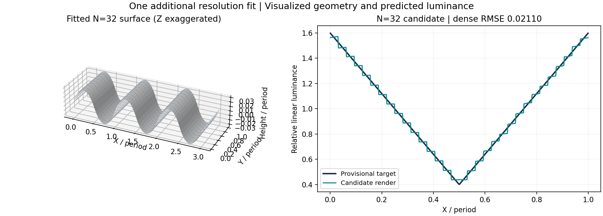
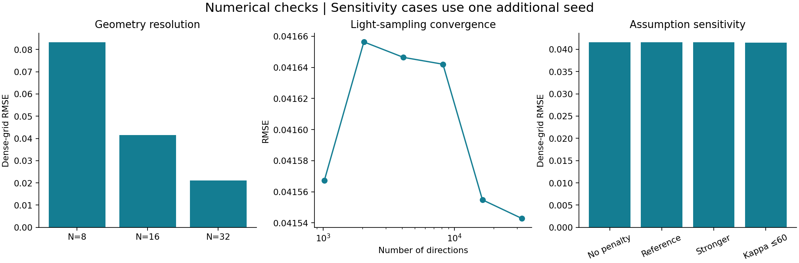

# Simulation results

Generated from `results/optimization/analysis.json`. These are deterministic simulations using the provisional target, not measurements from participants.

## Main result

A fitted bounded periodic surface and vMF light field approximate the target within this model. The N=16 free-surface candidate has dense-grid RMSE **0.04155**, versus **0.34640** for the flat control. An additional N=32 fit reduces RMSE to **0.02110**. Target mean luminance is one; those errors are approximately 4.16% and 2.11% of the target mean. They are not mean percentage errors or observer accuracy scores.

| Model | N | Dense RMSE | MAE | R-squared |
|---|---:|---:|---:|---:|
| Flat control | 16 | 0.34640 | 0.30000 | -0.0000 |
| Sinusoid | 16 | 0.05928 | 0.04822 | 0.9707 |
| Square-like | 16 | 0.14801 | 0.11537 | 0.8174 |
| Free surface | 16 | 0.04155 | 0.03588 | 0.9856 |
| Free surface: resolution check | 32 | 0.02110 | 0.01813 | 0.9963 |

Primary comparisons use 16,384 directions and 15 sample points per segment. The N=32 case is an additional one-seed sensitivity run; it does not have the same three-seed search and fine-refinement protocol as the primary N=16 comparison. R-squared is descriptive profile matching, not an inferential test.

The 3D view exaggerates the Z axis; its grayscale is illustrative rather than a calibrated display stimulus.

## What the fitted surface tells us

The free fit is a shallow corrugation; its geometry is not constrained to look like a rectangular square wave. Its maximum absolute reference height is 0.03365 periods and maximum absolute slope is 0.24840. It satisfies the height and slope bounds. The fitted reference light has azimuth 140.70 degrees, elevation 14.56 degrees, and kappa 21.628.

This establishes a candidate image match for a bounded height field. It does not demonstrate that the particular square-like surface an observer reports seeing has been recovered. Shape/light parameters are nonunique, and the Y-invariant geometry makes mirror directions equivalent in the exact integral.

## Numerical resolution matters

For the same selected N=16 parameters, midpoint-only evaluation gives RMSE 0.00215. Evaluating the entire segments with 15 samples gives 0.04155; 31 samples gives 0.04162. A midpoint-only error would therefore materially overstate the fit quality.

At fixed 15 samples per segment, raising the direction count from 16,384 to 32,768 changes RMSE from 0.04155 to 0.04154. This light-sampling change is small relative to the total residual for this candidate. Geometry resolution remains influential: N=8, 16, and 32 do not represent the same set of surfaces.

| Change from reference | Dense RMSE |
|---|---:|
| N8 | 0.08322 |
| N32 | 0.02110 |
| no_smoothness | 0.04158 |
| stronger_smoothness | 0.04156 |
| kappa60 | 0.04154 |

The sensitivity cases are warm-started, one-seed diagnostics. They do not exhaust the larger parameter spaces. The kappa=60 case changes the permitted upper bound, not the actual fitted kappa fixed at 60. The selected fitted kappa is saved in JSON.

## Search status and limits

All three reference free-surface differential-evolution searches hit their iteration cap; the final selected local Powell refinements terminated successfully. A local stopping message is not a proof of global optimality. The three free runs share a fixed-shape initialization. Differences across seeds reflect search variability, not biological uncertainty or confidence intervals.

The target is an ideal mathematical triangle wave with provisional mean, contrast, and phase. No brightness gain or offset is fitted. The current model omits interreflection, specular effects, overhangs, display calibration, and any perceptual response model.

## Reproducible evidence

- `results/optimization/fits.json`: all 12 reference searches, parameters, settings, timings, and solver messages.
- `results/optimization/analysis.json`: refined candidates, dense evaluations, all seed reevaluations, sensitivity cases, and convergence values.
- `results/optimization/model_comparison.csv`: primary comparison metrics.
- `results/optimization/fitted_profiles.csv`: target and prediction samples for primary fits.
- `results/optimization/sensitivity.json`: additional cases, including all N=32 height and lighting parameters.
- `results/validation.json`: 15 physical/numerical checks.
- `test_project.py`: eight regression tests, including synthetic kappa recovery.

The findings apply to the specified target, surface class, lighting assumptions, and optimization bounds. See [limitations and future work](LIMITATIONS.md).
